# EmoReward visual results

Original videos, poster frames, and method figures reused from the [project website repository](https://github.com/emoreward-project/emoreward-project.github.io). Media bytes are unchanged.

Click a poster to open its MP4, or use the project page for synchronized playback. [Return to the main README](../../README.md).

- **GT**: the pretrained generator, without RL.
- **Baseline**: the corresponding RL algorithm with its default reward.
- **Reflect (without RewardMemory)**: instance-level gating with unit memory multipliers.
- **EmoReward**: Reflect composed with the frozen RewardMemory table.

## HunyuanVideo 1.5 · Backstage at dusk

[Play this comparison on the project page](https://emoreward-project.github.io/#backstage).

| Method | Preview (click to open MP4) |
| --- | --- |
| GT (pretrained, no RL) | [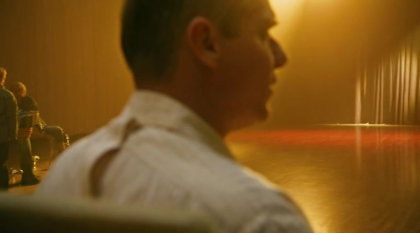](./backstage-1.mp4?raw=true) |
| EmoReward | [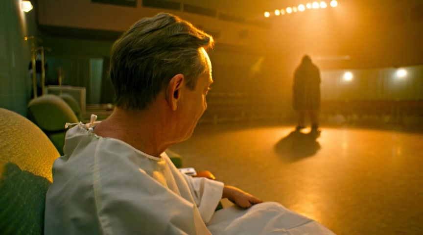](./backstage-2.mp4?raw=true) |

## DanceGRPO · Street-corner hesitation

[Play this comparison on the project page](https://emoreward-project.github.io/#dance).

| Method | Preview (click to open MP4) |
| --- | --- |
| Baseline | [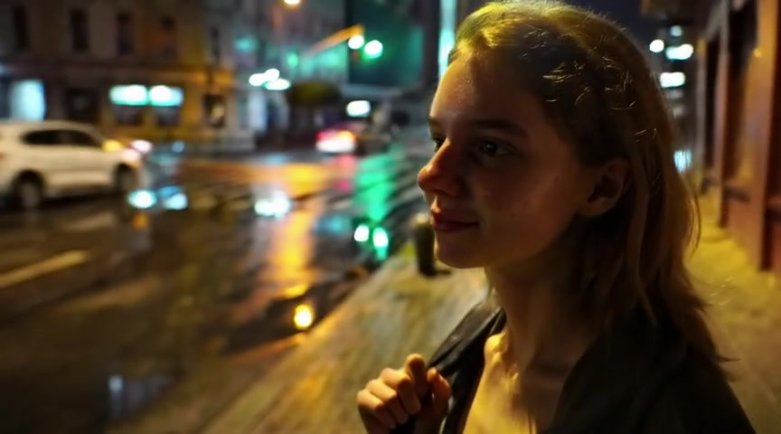](./dance-1.mp4?raw=true) |
| Reflect (without RewardMemory) | [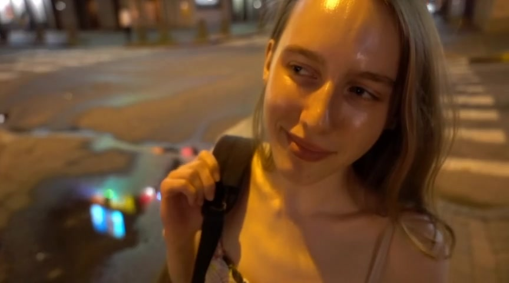](./dance-3.mp4?raw=true) |
| EmoReward | [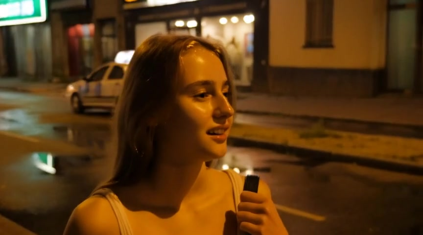](./dance-2.mp4?raw=true) |

Full generation prompt

The camera slowly pushes in on a young woman standing at a street corner under the dim yellow glow of a streetlight, captured in a medium close-up. Side backlighting outlines her slender silhouette. Her hand unconsciously tightens around the backpack strap, knuckles turning slightly white, while a faint, forced smile tugs at her lips—never reaching her eyes. Her gaze drifts away from the front, settling on a puddle on the ground, where neon signs flicker and reflect like the instability of her emotions. She slightly turns her head, her lips twitching as if about to speak, but only a soft cough escapes. She lowers her head, her long hair falling to veil half her face. A breeze lifts her strands, and she instinctively reaches up to brush them aside, her fingers pausing in midair before dropping weakly. In the background, blurred traffic and pedestrians move past, their noise isolated beyond the frame, leaving her alone in the shifting light, trembling slightly, as if the entire world has gone silent except for the clear, pounding rhythm of her heartbeat in her ears.

## FlowGRPO · Twilight on the stone steps

[Play this comparison on the project page](https://emoreward-project.github.io/#flow).

| Method | Preview (click to open MP4) |
| --- | --- |
| Baseline | [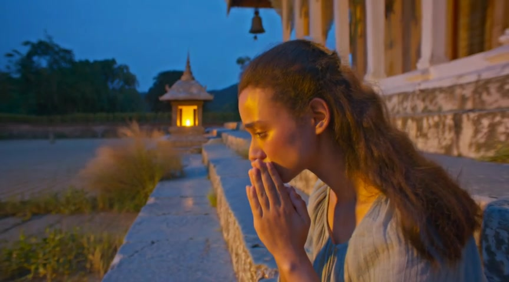](./flow-1.mp4?raw=true) |
| Reflect (without RewardMemory) | [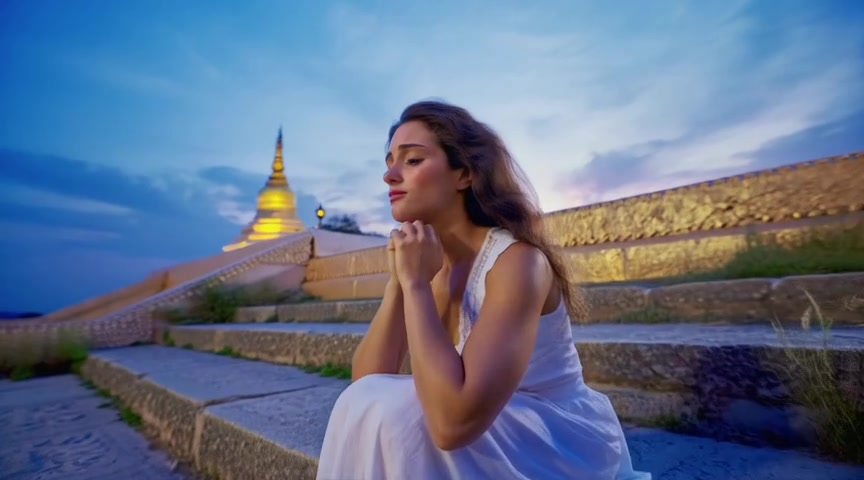](./flow-3.mp4?raw=true) |
| EmoReward | [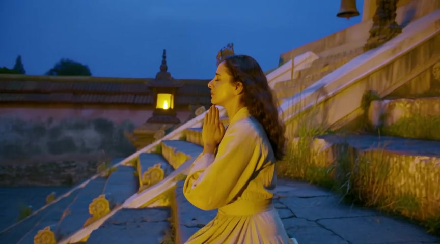](./flow-2.mp4?raw=true) |

Full generation prompt

The camera slowly pushes in on a young woman kneeling on ancient bluish stone steps, her back turned to the deepening twilight sky, hands folded gently on her knees, fingertips trembling faintly. Her face is bathed in warm gold by the slanting rays of the setting sun, her eyelashes lowered, her pupils reflecting the flickering oil lamp at the distant temple eaves—a silent mirror to some unspoken obsession. Her lips are slightly pursed, the line of her mouth taut, as if silently praying or suppressing a sigh that threatens to break free. She tilts her head upward, gazing into the night sky, a single tear slipping down her cheek, pausing at her chin, glimmering in the dim light. A breeze stirs her hair, her sleeve lifts slightly, her arm quivers faintly, as though awaiting a response that will never come. Behind her, a quiet courtyard lies still, wild grasses growing beside the stone steps, while in the distance, a bell tolls gently, echoing through the empty dusk. The entire scene is enveloped in a near-sacred sense of solitude.

## SAGE-GRPO · Composure under the spotlight

[Play this comparison on the project page](https://emoreward-project.github.io/#sage).

| Method | Preview (click to open MP4) |
| --- | --- |
| Baseline |  |
| Reflect (without RewardMemory) | [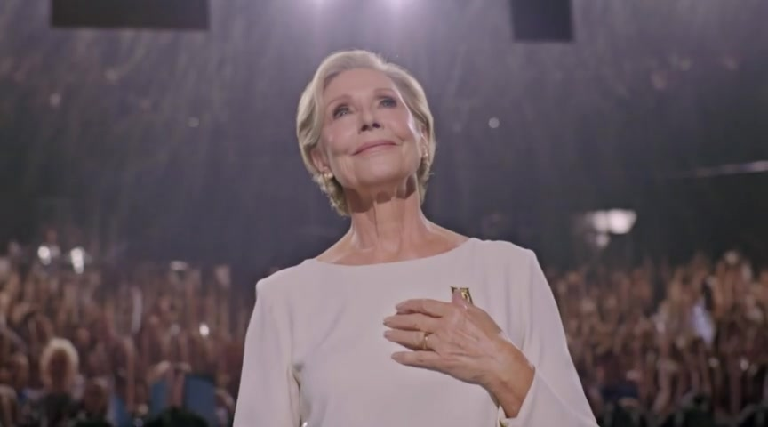](./sage-3.mp4?raw=true) |
| EmoReward | [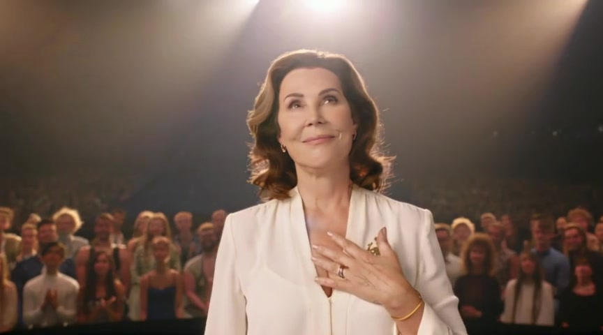](./sage-2.mp4?raw=true) |

Full generation prompt

The camera slowly pushes in, revealing a middle-aged woman standing at the center of the stage, bathed in a spotlight that cascades from the upper side, softly outlining her silhouette with quiet strength. She tilts her head slightly upward, a subtle smile forming on her lips—a smile long held within, unassuming yet powerful enough to pierce the silence. Her gaze sweeps across the audience, her eyes glowing with a gentle warmth, like melting snow in winter, reflecting countless looks of reverence. Her fingers gently trace the emblem on her chest, her fingertips trembling slightly, as if touching a memory sealed by time. Slowly, she raises her hand and grasps the microphone, her lips parting slightly as her voice emerges—low, clear, each word like amber seeping from the depths of her soul. Her eyes never leave the audience, a look of calm acceptance and quiet response, as if saying: every step I’ve taken is worth being seen. Behind her, the applause blurs into soft waves, the melody gentle and hushed, while her face, stretched by light and shadow, resembles a still oil painting, frozen in her moment of radiant glory.

## Reward-policy comparison

[Play this comparison on the project page](https://emoreward-project.github.io/#policies).

| Method | Preview (click to open MP4) |
| --- | --- |
| GT (pretrained, no RL) | [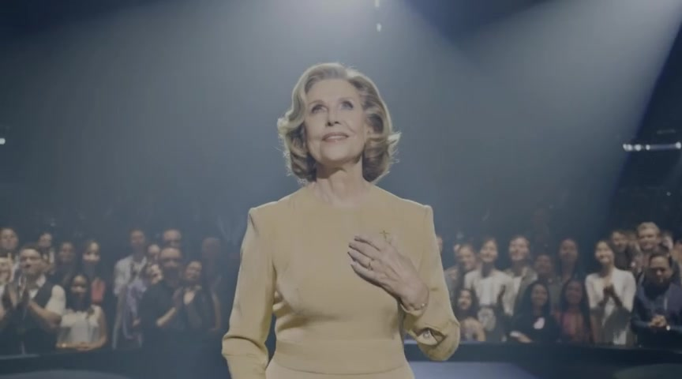](./policies-4.mp4?raw=true) |
| VideoAlign only | [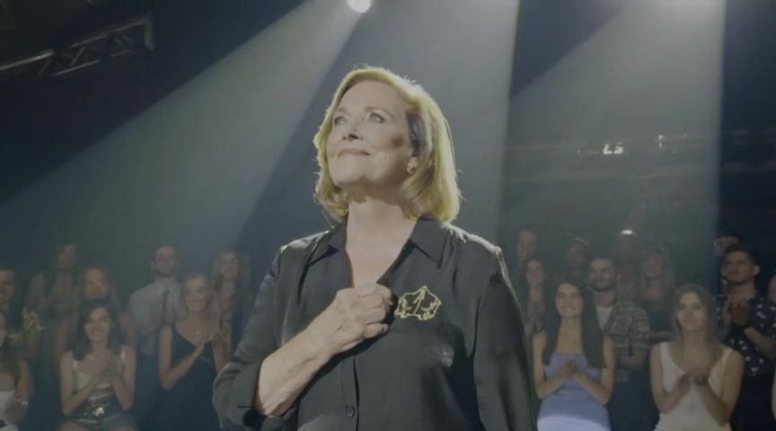](./policies-8.mp4?raw=true) |
| Single provider: R1-Omni | [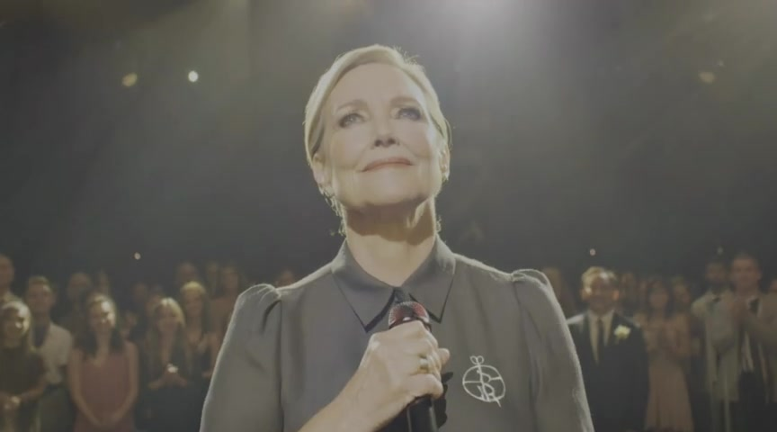](./policies-7.mp4?raw=true) |
| Random routing | [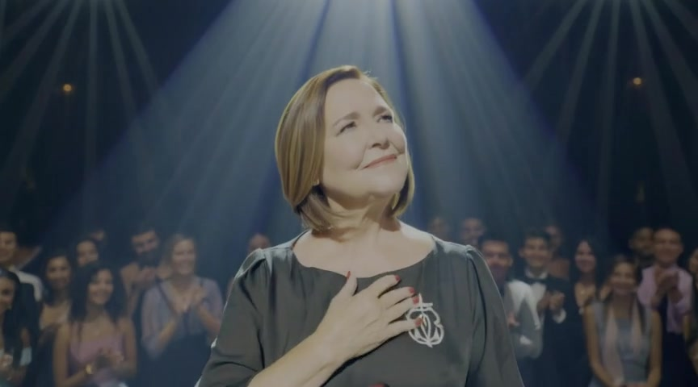](./policies-5.mp4?raw=true) |
| Round-robin routing | [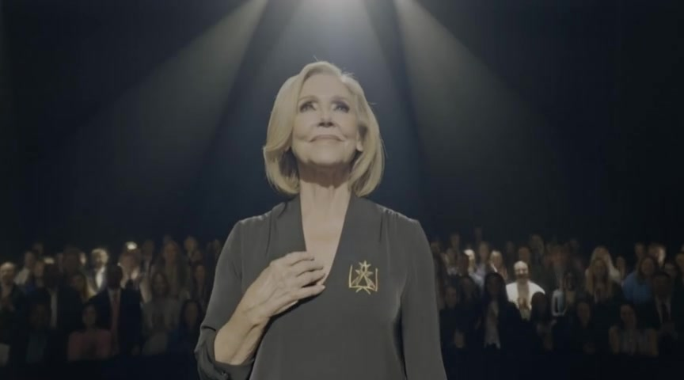](./policies-6.mp4?raw=true) |
| Fixed fusion | [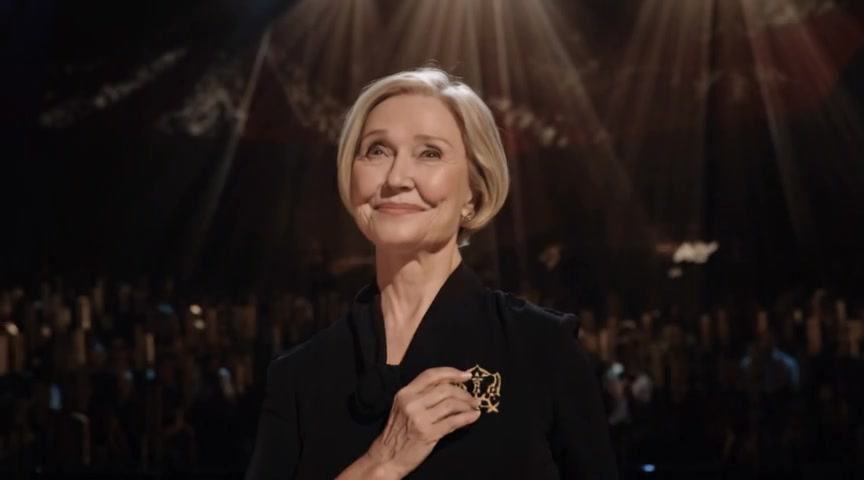](./policies-3.mp4?raw=true) |
| Reflect (without RewardMemory) |  |
| EmoReward |  |

Full generation prompt

The camera slowly pushes in, revealing a middle-aged woman standing at the center of the stage, bathed in a spotlight that cascades from the upper side, softly outlining her silhouette with quiet strength. She tilts her head slightly upward, a subtle smile forming on her lips—a smile long held within, unassuming yet powerful enough to pierce the silence. Her gaze sweeps across the audience, her eyes glowing with a gentle warmth, like melting snow in winter, reflecting countless looks of reverence. Her fingers gently trace the emblem on her chest, her fingertips trembling slightly, as if touching a memory sealed by time. Slowly, she raises her hand and grasps the microphone, her lips parting slightly as her voice emerges—low, clear, each word like amber seeping from the depths of her soul. Her eyes never leave the audience, a look of calm acceptance and quiet response, as if saying: every step I’ve taken is worth being seen. Behind her, the applause blurs into soft waves, the melody gentle and hushed, while her face, stretched by light and shadow, resembles a still oil painting, frozen in her moment of radiant glory.

## Provider-pool ablation

[Play this comparison on the project page](https://emoreward-project.github.io/#providers).

| Method | Preview (click to open MP4) |
| --- | --- |
| VideoAlign only | [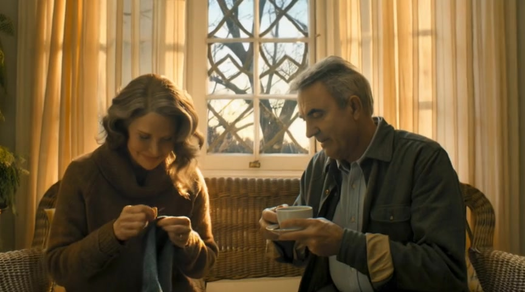](./providers-4.mp4?raw=true) |
| Semantic emotion | [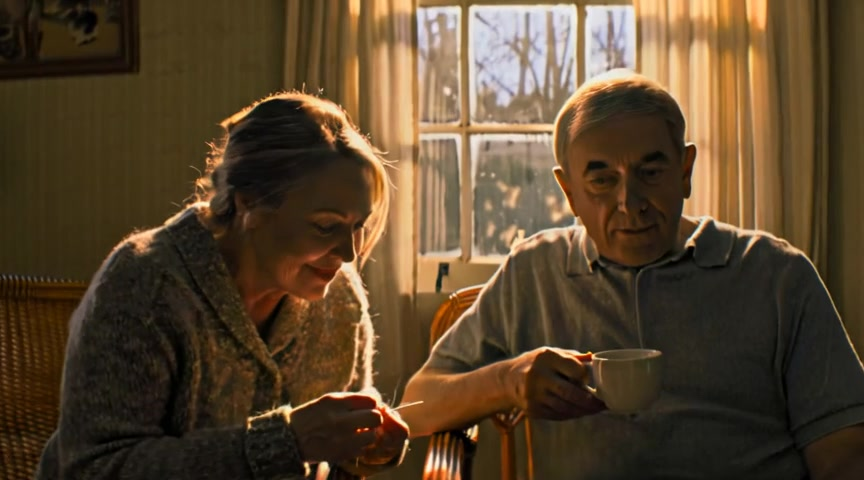](./providers-3.mp4?raw=true) |
| Motion naturalness | [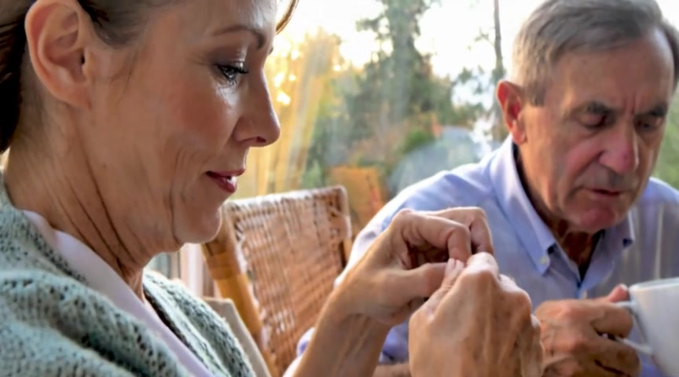](./providers-2.mp4?raw=true) |
| Balanced pool | [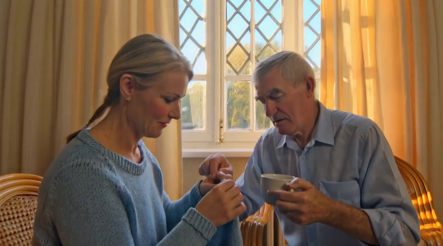](./providers-1.mp4?raw=true) |

Provider weights and curricula also differ; this comparison does not isolate each channel's causal effect.

## RewardMemory ablation

[Play this comparison on the project page](https://emoreward-project.github.io/#memory).

| Method | Preview (click to open MP4) |
| --- | --- |
| Reflect (without RewardMemory) |  |
| EmoReward |  |

Full generation prompt

The camera slowly pushes in, revealing a middle-aged woman standing at the center of the stage, bathed in a spotlight that cascades from the upper side, softly outlining her silhouette with quiet strength. She tilts her head slightly upward, a subtle smile forming on her lips—a smile long held within, unassuming yet powerful enough to pierce the silence. Her gaze sweeps across the audience, her eyes glowing with a gentle warmth, like melting snow in winter, reflecting countless looks of reverence. Her fingers gently trace the emblem on her chest, her fingertips trembling slightly, as if touching a memory sealed by time. Slowly, she raises her hand and grasps the microphone, her lips parting slightly as her voice emerges—low, clear, each word like amber seeping from the depths of her soul. Her eyes never leave the audience, a look of calm acceptance and quiet response, as if saying: every step I’ve taken is worth being seen. Behind her, the applause blurs into soft waves, the melody gentle and hushed, while her face, stretched by light and shadow, resembles a still oil painting, frozen in her moment of radiant glory.

